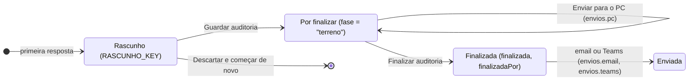
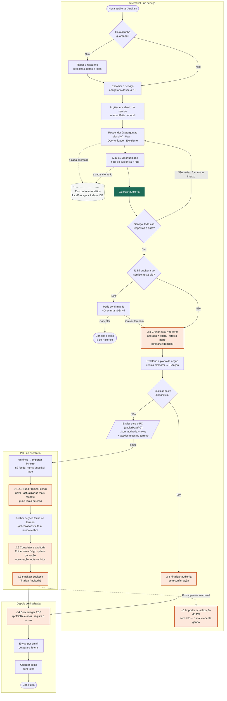

<!--
  Auditoria 5S · Supermercados Kaizen — Fluxo de uma auditoria
  Fluxograma (Mermaid, que o GitHub desenha) do caminho de uma auditoria, do
  formulário no telemóvel ao PDF enviado e à cópia de segurança. Escrito para a
  versão 4.7.1. Os nomes entre parênteses são funções de index.html.
-->

# Fluxo de uma auditoria

Do formulário no telemóvel, no serviço, até ao PDF enviado e à cópia de
segurança. Para o uso no dia-a-dia, ver o [Guia](GUIA.md); para os pormenores
técnicos, o [README](README.md).

- [Estados](#estados)
- [Fluxograma](#fluxograma)
- [Pontos a rever](#pontos-a-rever)

## Estados

As auditorias gravadas antes de 3.25.0 não têm `fase` e contam como
finalizadas.

## Fluxograma

Os nós a laranja, com ⚠ e um número, são os [pontos a rever](#pontos-a-rever).
As setas a tracejado são caminhos opcionais.

## Pontos a rever

| # | O que acontece | Onde | Efeito | Sugestão | Peso |
| --- | --- | --- | --- | --- | --- |
| 1 | A fusão substitui o registo inteiro pela versão mais recente. | `planoFusao()`, importação | Se o telemóvel e o PC alteram a mesma auditoria depois do envio, uma das alterações perde-se sem aviso. | Fundir as acções por id; avisar quando as duas versões mudaram desde o envio. | Alta |
| 2 | «Mais recente» é decidido pelo relógio de cada dispositivo. | `maisRecente()`, campo `alterada` | Um telemóvel com a hora adiantada pode passar por cima de uma auditoria já finalizada no PC. | Uma auditoria finalizada nunca é substituída por uma por finalizar. | Alta |
| 3 | Finalizar não pede confirmação nem verifica o plano. | `finalizarAuditoria()`, botão `pa-fim` | Finaliza-se por engano, ou com perguntas Mau sem nenhuma acção. Depois disso, editar já pede o código. | Confirmação, com aviso de «plano de acção vazio». | Média |
| 4 | Descarregar o PDF ou enviar muda a data de alteração. | `marcarEnvio()` → `tocar()` | Um simples PDF no PC torna essa versão «mais recente» e agrava o ponto 1. | Registar o envio sem mexer em `alterada`, como já faz `envios.pc`. | Média |
| 5 | A edição de uma auditoria gravada não tem rascunho. | `guardarRascunho()` sai se `editId` | Se o sistema fechar o separador no telemóvel, o que se editou perde-se. | Rascunho também em edição, com a chave do id. | Média |
| 6 | As fotos gravam-se depois, em segundo plano. | `gravarEvidencias()` | Se falhar, a auditoria fica sem fotos e só aparece um aviso. | Manter as fotos do rascunho até a gravação delas se confirmar. | Baixa |
